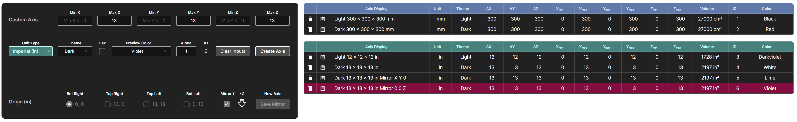
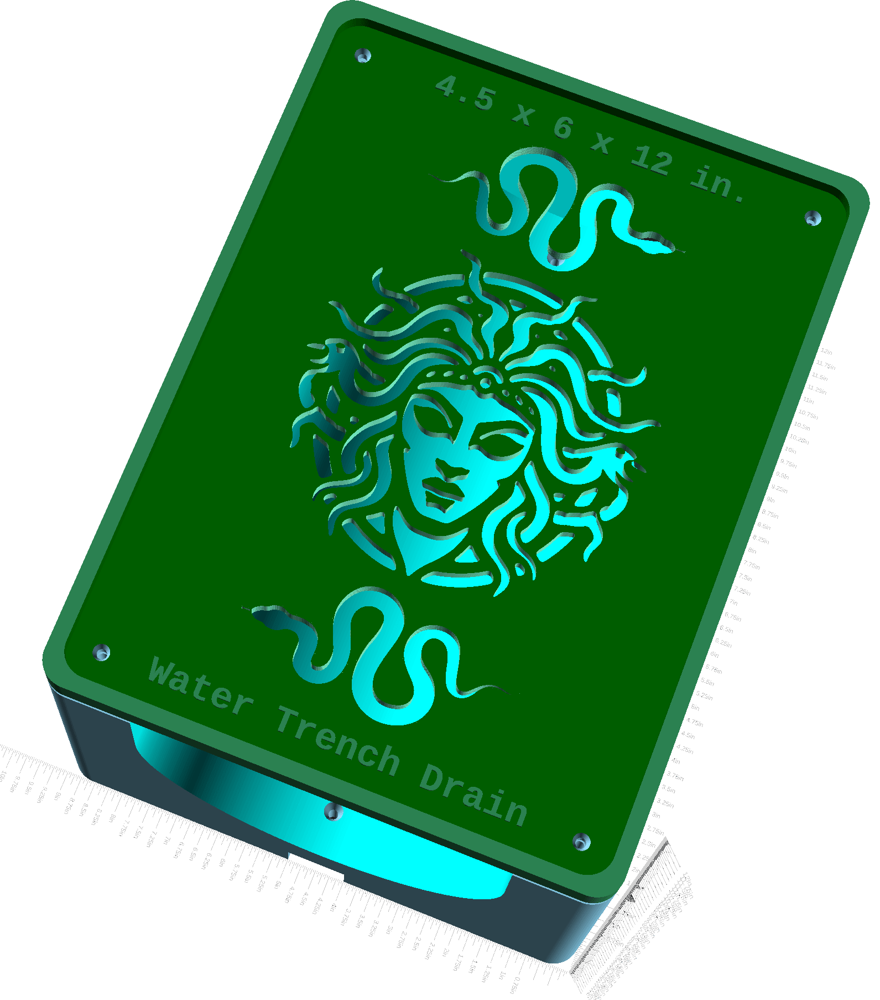
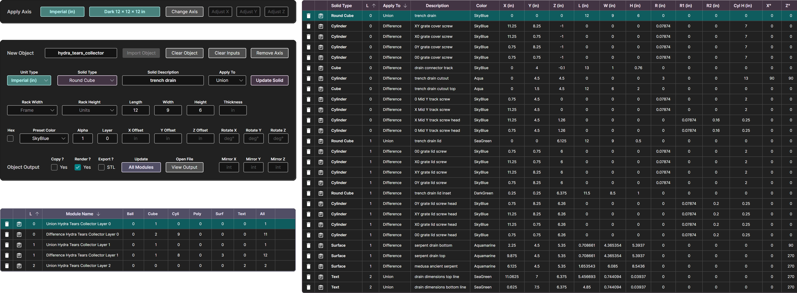
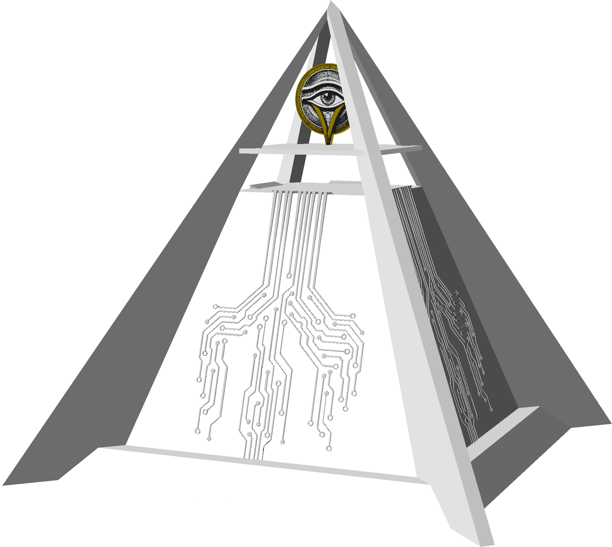

 #  NetGenCAD
###### 
#### Description
This application is a no-code tool for generating custom objects used in OpenSCAD, a solid 3D CAD modeler. **It is assumed that users have a basic understanding of OpenSCAD and its functionalities.** 
###### 
#### Prerequisites
* **You need a CAD renderer installed (OpenSCAD recommended):** [OpenSCAD](https://openscad.org/downloads.html)
* [NetGenCAD for Windows (x64)](NetGenCAD.UI/NetGenCAD.UI.Windows/NetGenCAD-0.1.0-winx64.7z)
* **NetGenCAD for Linux (x64 & arm64)** Coming Soon!
* **NetGenCAD for MacOS (x64 & arm64)** Coming Soon!

###### 
#### Types of Solids Available
* **Cube** - default aligned on 0,0,0 axes. Can be offset with Adjust X, Y, Z values.
* **Cylinder** - all cylinders are aligned on 0,0,0 axes, with center point at center of circle.
* **Polyhedron** - created in Shape Designer, and multiple polyhedrons can be used within Object Designer.
* **Rounded Cube** - Minkowski rounding using offsets to align to 0,0,0 axes
* **Rounded Cylinder** - Minkowski rounding using offsets to align to 0,0,0 axes. Center is center of circle.
* **Sphere** - all spheres are aligned on the 0,0,0 axes, with center point of the sphere at 0,0,0.
* **Surface** - import from png or dat file. Default aligned on 0,0,0 axes or can be offset with translate.
* **Text** - create 3D text using OpenSCAD text function with approximate bounding box dimensions.

###### 
#### Solid Adjustments Available
* **Rotate** - rotate along X, Y, and/or Z axis when creating/updating a solid
* **Scale** - scale along X, Y, and/or Z axis when importing an image or dat file
* **Translate** - place the solid at specified position, along X, Y, and/or Z axis
* **Color** - apply color to the solid being created/updated
* **Alpha** - apply transparency to the solid being created/updated
* **Layer** - exclusive NetGenCAD feature for specifying solid difference or intersections

###### 
#### Object Adjustments Available
* **Mirror** - mirror along X, Y, and/or Z axis when exporting or viewing the object
* **Copy** - create duplicates of the object being created/updated
* **Render** - applies optimized rendering of solids before viewing or exporting the object
* **Export** - export the object as an STL file for 3D printing or other uses

######
#### Types of Measurements
* **Metric axis** - 20mm, 10mm, 5mm, and 1mm increments
* **Imperial axis** - 1/4", 1/8", 1/16", and 1/32" increments
* **Convert mm to inches** - Enter inputs in Metric (mm) first, then select Imperial (in)
* **Convert inches to mm** - Enter inputs in Imperial (in) first, then select Metric (mm)

###### 
#### Custom Axes Builder
* Customize axes with your own color. Preview the axis and/or colors in your SCAD project.
* Mirror functionality available for all axes. Preview mirrored axes in your SCAD project.

###### 

######
#### Examples of Objects Created
###### 

###### 

###### 

###### 

###### 
#### Generated SCAD Files
| Files                                   | Usage In Your SCAD File / Description                  | Optional parameters |
| --------------------------------------- |:------------------------------------------------------:|:-------------------:|
| Scad/Axes/axes.scad                     | holds all stored axes used in 3D models                |                     |
| Scad/Axes/axis_preview.scad             | preview a newly created axis and mirror                | colorVal, alpha     |
| Scad/Axes/custom_axis_name.scad         | use <Axes/axes.scad>; Get_Custom_Axis_Name();          | colorVal, alpha     |
| Scad/Solids/moduleType_name_object.scad | include <object_name_type.scad>;                       |                     |
| Scad/Solids/object.scad                 | main object file for 3D model                          |                     |	
| Scad/Solids/object.stl                  | exported STL file for 3D model                         |                     |
| Scad/Solids/polyhedronName_shape.scad   | polyhedron shape preview file                          |                     |
| Scad/Images/image_surface.png           | imported image used for a Surface                      |                     |
| Scad/Images/image_surface_**frmt**.png  | **formatted** image used for a Surface                 | format box checked  |
