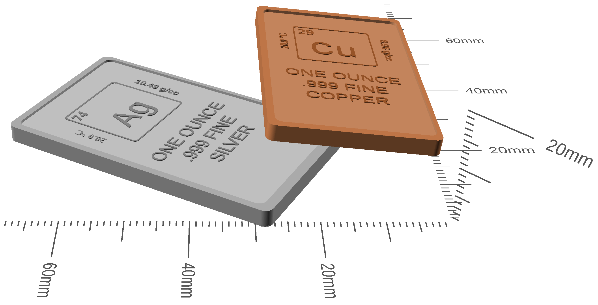
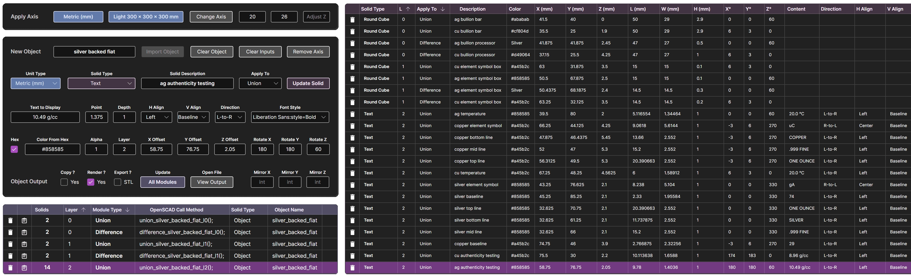
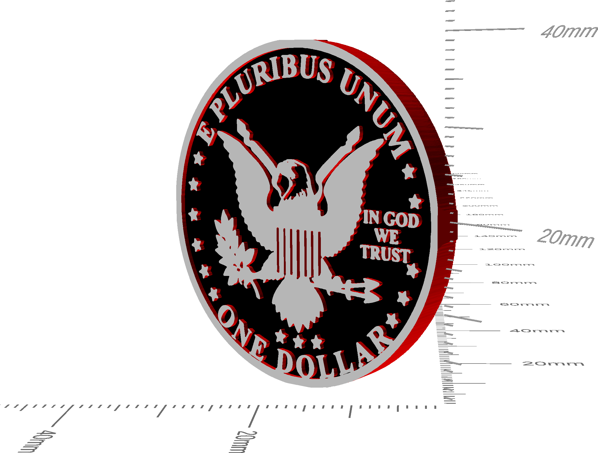
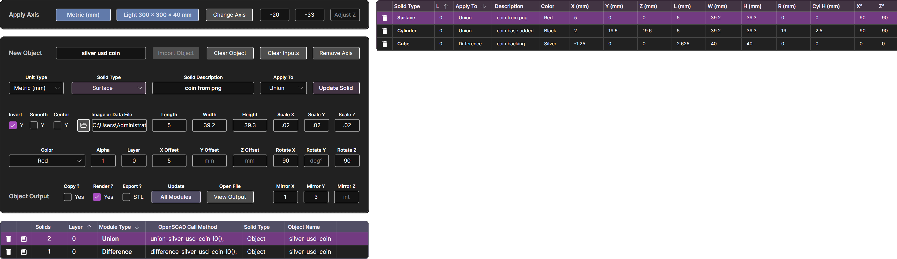
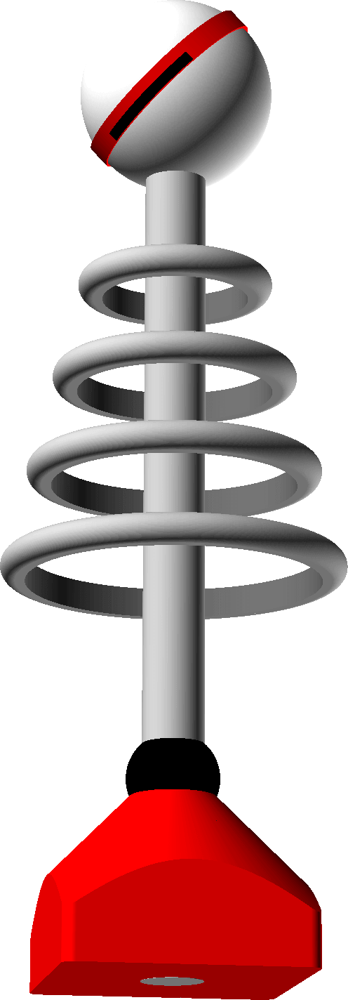
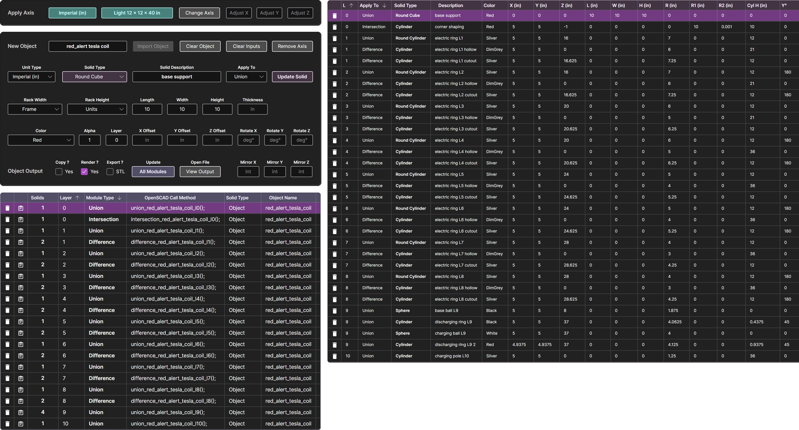

 #  NetGenCAD
###### 
#### Description
This application is a no-code tool for generating custom objects used in OpenSCAD, a solid 3D CAD modeler. **It is assumed that users have a basic understanding of OpenSCAD and its functionalities.** 
###### 
#### Prerequisites
* **You need a CAD renderer installed (OpenSCAD recommended):** [OpenSCAD](https://openscad.org/downloads.html)
* [NetGenCAD for Windows (x64)](NetGenCAD.UI/NetGenCAD.UI.Windows/NetGenCAD-0.0.6-winx64.7z)
* **NetGenCAD for Linux (x64 & arm64)** Coming Soon!
* **NetGenCAD for MacOS (x64 & arm64)** Coming Soon!

###### 
#### Types of Solids Available
* **Cube** - default aligned on 0,0,0 axes. Can be offset with Adjust X, Y, Z values.
* **Cylinder** - all cylinders are aligned on 0,0,0 axes, with center point at center of circle.
* **Polyhedron** - created in Shape Designer, and multiple polyhedrons can be used within Object Designer.
* **Rounded Cube** - Minkowski rounding using offsets to align to 0,0,0 axes
* **Rounded Cylinder** - Minkowski rounding using offsets to align to 0,0,0 axes. Center is center of circle.
* **Sphere** - all spheres are aligned on the 0,0,0 axes, with center point of the sphere at 0,0,0.
* **Surface** - import from png or dat file. Default aligned on 0,0,0 axes or can be offset with translate.
* **Text** - create 3D text using OpenSCAD text function with approximate bounding box dimensions.

###### 
#### Examples of Objects Created
###### 

###### 

###### 

###### 

###### 
#### Solid Adjustments Available
* **Rotate** - rotate along X, Y, and/or Z axis when creating/updating a solid
* **Scale** - scale along X, Y, and/or Z axis when importing an image or dat file
* **Translate** - place the solid at specified position, along X, Y, and/or Z axis
* **Color** - apply color to the solid being created/updated
* **Alpha** - apply transparency to the solid being created/updated
* **Layer** - exclusive NetGenCAD feature for specifying solid difference or intersections

###### 
#### Object Adjustments Available
* **Mirror** - mirror along X, Y, and/or Z axis when exporting or viewing the object
* **Copy** - create duplicates of the object being created/updated
* **Render** - applies optimized rendering of solids before viewing or exporting the object
* **Export** - export the object as an STL file for 3D printing or other uses

###### 
#### Layout of Custom Axes Builder
The Custom Axes Builder has 2 main visual sections: Custom Axis and Generated Axes. The outputs of newly created axes will show up in the tables next to the Custom Axis section.

**Create an axis**

1. Enter the minimum and maximum X, Y, and Z coordinates, and select the measurement unit and theme.
2. Optionally choose an OpenSCAD named color from **Preview Color**, or check **Hex** and enter a color as `#RGB` or `#RRGGBB`. If no color is chosen, the theme determines the default: black for Light and white for Dark.
3. Set **Alpha** to an opacity from 0 to 1. The default is 1 (opaque); lower values are more transparent. Alpha is rounded to three decimal places and has a minimum effective value of 0.01, including when 0 is entered.
4. Select **Create Axis**. The chosen color and alpha become defaults for the created axis, which appears in the generated axes list and opens in a preview.

**Preview and mirror an axis**

Create an axis or select one from the generated axes list, then use **View Output** to open its preview in the default SCAD application. Changing **Preview Color**, **Hex**, or **Alpha** updates the preview without changing the existing axis. **Clear Inputs** resets the inputs and color selection. Preview changes rewrite the preview file, which may require reloading it in the SCAD application.

Use the origin choices to preview reflections within the axis bounds: **Bot Right** is the original orientation, **Top Right** mirrors X, **Top Left** mirrors X and Y, and **Bot Left** mirrors Y. The Z mirror checkbox independently flips the axis within its Z bounds and can be combined with any corner. These options reflect the geometry and labels, not the OpenSCAD camera; they do not change the original axis.

To keep a mirrored orientation, choose at least one reflection and select **Save Mirror**. This creates a separate axis with its own calling method and file, using the current preview color and alpha as its defaults. If no preview color is selected, the source axis color is used. The generated axes list refreshes and the preview calls the saved axis; the new axis can be used or deleted independently of the original. To create another orientation, select the original axis again. Saving the same compatible variant again updates it instead of creating a duplicate.

The mirrored calling method encodes the millimeter translation and reflected axes, for example `_Orig_300_x_0_x_0_Mirror_X_0_0`. Negative signs are encoded as `N` and decimal points as `D`.
###### 

###### 
#### Types of Measurements
Varying axes of different sizes, measurement types, colors, and combinations of both metric and imperial measurements can be applied within the same SCAD project. Axes are managed in an aggregate SCAD file and are called as modules within your SCAD project. The app manages updates to existing axes as well as provides the ability for multiple axis types to be used in your project. Axis increments are as follows:
###### 
* **Metric axis** - 20mm, 10mm, 5mm, and 1mm increments
* **Imperial axis** - 1/4", 1/8", 1/16", and 1/32" increments
* **Convert mm to inches** - Enter inputs in Metric (mm) first, then select Imperial (in)
* **Convert inches to mm** - Enter inputs in Imperial (in) first, then select Metric (mm)

Each object and its solids share one axis reference. Changing or clearing a solid's axis updates the object and its other solids; a new solid without an axis inherits the object's axis. When existing data is migrated, the newest solid's axis is used for its object (creation timestamp, then ID as a tiebreaker). Missing referenced axes must be corrected before migration.

###### 
#### Generated SCAD Files

Code can remove a generated axis with `GUI.RemoveAxis(outputDirectory, callingMethod)`, using the calling method returned by `GUI.SetAxis` or retrieved from the database. It removes matching generated entries from `axes.scad` and deletes their included axis file; it does not change database records. Missing, malformed, or shared entries are reported rather than deleting a potentially unrelated file. If file deletion fails after the index is updated, the error is propagated and the axis file may need to be removed separately.

| Files                                   | Usage In Your SCAD File / Description                  | Optional parameters | Render |
| --------------------------------------- |:------------------------------------------------------:|:-------------------:|:------:|
| Scad/Axes/axes.scad                     | Description: holds all stored axes used in 3D models   |                     |	No    |
| Scad/Axes/custom_axis_name.scad         | Syntax: use <Axes/axes.scad>; Get_Custom_Axis_Name();  | colorVal, alpha     |	No    |
| Scad/Solids/moduleType_name_object.scad | Syntax: include <object_name_type.scad>;               |                     |	Yes   |
| Scad/Solids/object.scad                 | Description: main object file for 3D model             |                     |	No    |	
| Scad/Solids/object.stl                  | Description: exported STL file for 3D model            |                     |  Yes   |
| Scad/Solids/polyhedronName_shape.scad   | Description: polyhedron shape preview file             |                     |	No    |
